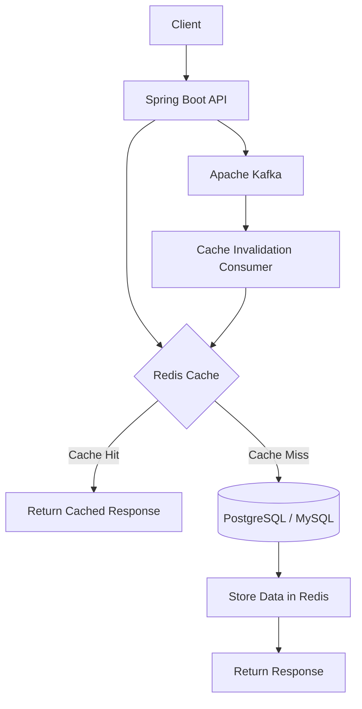

# Redis + Spring Boot — Production-Oriented Complete Guide


> A complete, production-oriented guide for integrating **Redis with Spring Boot** — covering caching, sessions, distributed locks, rate limiting, leaderboards, Pub/Sub, Redis Streams, persistence, high availability, security, monitoring, Docker, Kubernetes, testing, and real-world system design.

---

## 📌 About This Repository

This repository is a structured learning path and production reference for using **Redis with Spring Boot** in real backend systems.

It is designed for Java backend developers, microservice developers, and students who want to understand Redis not only as a cache, but as a complete low-latency data layer for modern distributed applications.

### What Makes This Guide Different?

- Production-oriented, not only beginner tutorials
- Complete Spring Boot code examples
- Redis CLI + Java implementation side by side
- Real-world use cases: caching, sessions, locks, rate limiting, feeds
- High availability: replication, Sentinel, Cluster
- Security, monitoring, Docker, Kubernetes, and testing
- Interview preparation with scenario-based questions
- Final Social Media Backend project using Redis, Kafka, and Spring Boot

---

## 🚀 Quick Start

### Prerequisites

- Java 17+
- Maven 3.8+
- Docker and Docker Compose
- Basic Spring Boot knowledge

### 1. Clone the Repository

```bash
git clone [https://github.com/SinghAnna/best-Redis---Spring-Boot.git](https://github.com/SinghAnna/best-Redis---Spring-Boot.git)
cd redis-spring-boot-guide
```

### 2. Start Redis Using Docker

```bash
docker compose up -d
```

### 3. Run Spring Boot Application

```bash
./mvnw spring-boot:run
```

### 4. Test Redis Connection

```bash
docker exec -it redis redis-cli ping
```

Expected output:

```text
PONG
```

### 5. Check Application Health

```bash
curl http://localhost:8080/actuator/health
```

---

## 🏗️ Architecture



### High-Level Flow

```text
Client
  |
  v
Spring Boot API
  |
  +--> Redis Cache
  |       |
  |       +--> Cache Hit: Fast response
  |       |
  |       +--> Cache Miss: Fetch from DB and cache it
  |
  +--> PostgreSQL / MySQL
  |
  +--> Kafka
          |
          +--> Cache invalidation
          |
          +--> Event-driven processing
```

Redis acts as the fast, temporary data layer, while the relational database remains the source of truth. Spring Data Redis provides Redis connectivity and integrates with the Spring Cache abstraction. [429][430]

---

## 🧰 Tech Stack

| Layer | Technology |
|---|---|
| Language | Java 17+ |
| Framework | Spring Boot 3.x |
| Cache / Data Store | Redis 7.x |
| Redis Client | Spring Data Redis + Lettuce |
| Database | PostgreSQL / MySQL |
| Messaging | Apache Kafka |
| Distributed Locks | Redisson |
| Monitoring | Spring Boot Actuator, Micrometer, Prometheus, Grafana |
| Containerization | Docker, Docker Compose |
| Orchestration | Kubernetes |
| Testing | JUnit 5, Mockito, Testcontainers, k6 |

---

## ✨ What You Will Learn

### Redis Fundamentals

- Redis architecture
- Redis data types
- TTL and expiration
- Redis commands
- Transactions and Lua scripting
- Memory management
- Persistence: RDB and AOF

### Spring Boot Integration

- Spring Data Redis setup
- Lettuce connection configuration
- `RedisTemplate`
- `StringRedisTemplate`
- Serializers
- Connection pooling
- Health checks

### Caching

- Cache-aside pattern
- Read-through cache
- Write-through cache
- Write-behind cache
- `@Cacheable`
- `@CachePut`
- `@CacheEvict`
- Cache invalidation
- Cache stampede, penetration, and avalanche

### Distributed Systems Patterns

- Distributed locks
- Rate limiting
- Leaderboards
- Online presence
- Idempotency
- Pub/Sub
- Redis Streams
- Kafka-based cache invalidation

### Production Operations

- Redis persistence
- Replication
- Sentinel
- Redis Cluster
- Monitoring
- Security
- Docker deployment
- Kubernetes deployment
- Testing
- Disaster recovery
- Production runbook

---

## 📚 Documentation Index

| Part | Topic | Status |
|---|---|---|
| 01 | Introduction to Redis | ✅ |
| 02 | Redis Data Types | ✅ |
| 03 | Redis Commands, TTL, Transactions and Lua | ✅ |
| 04 | Spring Data Redis Setup | ✅ |
| 05 | Redis Connection Configuration | ✅ |
| 06 | RedisTemplate Deep Dive | ✅ |
| 07 | Redis Serialization | ✅ |
| 08 | Spring Cache Abstraction | ✅ |
| 09 | `@Cacheable`, `@CachePut`, `@CacheEvict` | ✅ |
| 10 | Redis Cache Configuration | ✅ |
| 11 | Cache Invalidation Strategies | ✅ |
| 12 | User Session Management | ✅ |
| 13 | Distributed Locks | ✅ |
| 14 | Rate Limiting | ✅ |
| 15 | Leaderboards and Counters | ✅ |
| 16 | Redis Pub/Sub | ✅ |
| 17 | Redis Streams | ✅ |
| 18 | Redis Persistence | ✅ |
| 19 | Memory Management and Eviction | ✅ |
| 20 | Performance Optimization | ✅ |
| 21 | Redis Replication | ✅ |
| 22 | Redis Sentinel | ✅ |
| 23 | Redis Cluster | ✅ |
| 24 | High Availability Design | ✅ |
| 25 | Redis Security | ✅ |
| 26 | Monitoring and Observability | ✅ |
| 27 | Docker and Kubernetes Deployment | ✅ |
| 28 | Testing in Spring Boot | ✅ |
| 29 | Social Media Backend Project | ✅ |
| 30 | Production Checklist and Runbook | ✅ |

---

## 📁 Repository Structure

```text
redis-spring-boot-guide/
├── README.md
├── LICENSE
├── pom.xml
├── docker/
│   └── docker-compose.yml
├── docs/
│   ├── 01-introduction-to-redis.md
│   ├── 02-redis-data-types.md
│   ├── 03-redis-commands-ttl-transactions-lua.md
│   ├── 04-spring-data-redis-setup.md
│   ├── 05-redis-connection-configuration.md
│   ├── 06-redis-template-deep-dive.md
│   ├── 07-redis-serialization.md
│   ├── 08-spring-cache-abstraction.md
│   ├── 09-cacheable-cacheput-cacheevict.md
│   ├── 10-redis-cache-configuration.md
│   ├── 11-cache-invalidation-strategies.md
│   ├── 12-user-session-management.md
│   ├── 13-distributed-locks.md
│   ├── 14-rate-limiting.md
│   ├── 15-leaderboards-and-counters.md
│   ├── 16-redis-pub-sub.md
│   ├── 17-redis-streams.md
│   ├── 18-redis-persistence.md
│   ├── 19-memory-management-and-eviction.md
│   ├── 20-performance-optimization.md
│   ├── 21-redis-replication.md
│   ├── 22-redis-sentinel.md
│   ├── 23-redis-cluster.md
│   ├── 24-high-availability-design.md
│   ├── 25-redis-security.md
│   ├── 26-monitoring-and-observability.md
│   ├── 27-docker-kubernetes-deployment.md
│   ├── 28-testing-in-spring-boot.md
│   ├── 29-social-media-backend-project.md
│   └── 30-production-checklist-runbook.md
├── src/
│   └── main/
│       ├── java/
│       │   └── com/example/redis/
│       │       ├── config/
│       │       ├── controller/
│       │       ├── service/
│       │       ├── repository/
│       │       ├── dto/
│       │       ├── ratelimit/
│       │       ├── lock/
│       │       ├── stream/
│       │       └── pubsub/
│       └── resources/
│           ├── application.yml
│           └── application-local.yml
└── src/
    └── test/
        └── java/
            └── com/example/redis/
                ├── unit/
                └── integration/
```

---

## 🔑 Redis Key Naming Convention

This guide follows a predictable and production-safe Redis key naming convention:

```text
<service-name>:<entity>:<id>:<attribute>
```

### Examples

```text
user-service:user:101:profile
user-service:user:101:followers
post-service:post:201:likes
post-service:trending:posts
feed-service:user:101:timeline
auth-service:refresh-token:{tokenId}
rate-limit:user:101:endpoint:/posts
```

### Benefits

- Prevents key collisions between services
- Makes debugging easier
- Improves cache ownership clarity
- Supports multi-service Redis usage
- Makes monitoring and cleanup easier

---

## 🧠 Redis Usage Patterns

| Use Case | Redis Pattern |
|---|---|
| API response caching | Cache-aside |
| Database query caching | Cache-aside |
| User sessions | Redis Hash / Spring Session |
| Refresh tokens | Redis String / Hash |
| Token revocation | Redis blacklist |
| Distributed lock | `SET NX PX` / Redisson |
| Rate limiting | Fixed window / token bucket |
| Leaderboard | Sorted Set |
| Like counter | `INCR` |
| Trending posts | Sorted Set |
| Online presence | Bitmap / Set |
| Real-time notifications | Pub/Sub |
| Reliable event processing | Redis Streams / Kafka |

---

## 🛡️ Production Best Practices

### Caching

- Always set TTL for cache entries.
- Use TTL jitter to prevent cache avalanche.
- Cache DTOs, not raw JPA entities.
- Invalidate cache after database writes.
- Handle cache misses safely.
- Use key prefixes for service isolation.

### Reliability

- Configure connection timeouts.
- Configure command timeouts.
- Use connection pooling.
- Add database fallback when Redis is unavailable.
- Monitor Redis health continuously.
- Use replication and automatic failover for production.

### Security

- Never expose Redis to the public internet.
- Use authentication and ACL users.
- Enable TLS for untrusted networks.
- Restrict dangerous commands such as `FLUSHALL`, `FLUSHDB`, `CONFIG`, and `DEBUG`.
- Store secrets in a secret manager, not in Git.

### Performance

- Avoid `KEYS *` in production.
- Use `SCAN` for key iteration.
- Use pipelining for bulk operations.
- Avoid large values and large collections.
- Monitor hot keys and big keys.
- Use Redis Slow Log for latency troubleshooting.

---

## 🧪 Testing

This repository includes testing guidance for:

| Test Type | Tool | Purpose |
|---|---|---|
| Unit tests | JUnit 5 + Mockito | Test service logic with mocked Redis |
| Integration tests | Testcontainers | Test real Redis behavior |
| Cache tests | Spring Cache + Redis | Verify cache hit, miss, TTL |
| Lock tests | Redis / Redisson | Verify concurrent locking |
| Stream tests | Redis Streams | Verify consumer groups and ACK |
| Load tests | k6 / JMeter / Gatling | Verify latency and throughput |

---

## 📈 Monitoring Metrics

Important Redis metrics to monitor:

```text
redis_up
redis_memory_used_bytes
redis_memory_max_bytes
redis_connected_clients
redis_keyspace_hits_total
redis_keyspace_misses_total
redis_evicted_keys_total
redis_commands_processed_total
redis_slowlog_length
redis_replication_lag
```

### Cache Hit Ratio

```text
Cache Hit Ratio =
Cache Hits / (Cache Hits + Cache Misses)
```

A healthy cache usually targets a high hit ratio, but the exact target depends on workload and data access patterns.

---

## 🐳 Docker Compose Example

```yaml
services:
  redis:
    image: redis:7.4-alpine
    container_name: redis
    ports:
      - "127.0.0.1:6379:6379"
    environment:
      REDIS_PASSWORD: ${REDIS_PASSWORD}
    volumes:
      - redis_data:/data
    command: >
      redis-server
      --requirepass ${REDIS_PASSWORD}
      --appendonly yes
      --appendfsync everysec
      --maxmemory 512mb
      --maxmemory-policy allkeys-lru
    healthcheck:
      test: ["CMD-SHELL", "redis-cli -a \"$$REDIS_PASSWORD\" ping | grep -q PONG"]
      interval: 10s
      timeout: 5s
      retries: 5

volumes:
  redis_data:
```

---

## 🤝 Contributing

Contributions are welcome!

1. Fork the repository.
2. Create a new branch:

```bash
git checkout -b feature/your-feature
```

3. Commit your changes:

```bash
git commit -m "Add: your meaningful commit message"
```

4. Push the branch:

```bash
git push origin feature/your-feature
```

5. Open a Pull Request.

---

## 📄 License

This project is licensed under the MIT License.

---

## 🙌 Author

**Your Name**

- GitHub: [your-username](https://github.com/your-username)
- LinkedIn: [your-linkedin](https://www.linkedin.com/in/your-linkedin)

---

## ⭐ Support

If this repository helps you learn Redis with Spring Boot, please consider giving it a ⭐ on GitHub.

---

## 🔗 Useful Resources

- [Spring Data Redis Documentation](https://docs.spring.io/spring-data/redis/reference/)
- [Redis Official Documentation](https://redis.io/docs/latest/)
- [Spring Boot Documentation](https://docs.spring.io/spring-boot/index.html)
- [Redisson Documentation](https://redisson.pro/docs/)
- [Apache Kafka Documentation](https://kafka.apache.org/documentation/)
